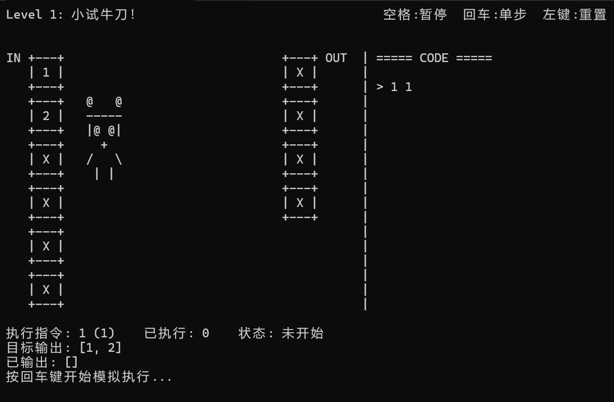
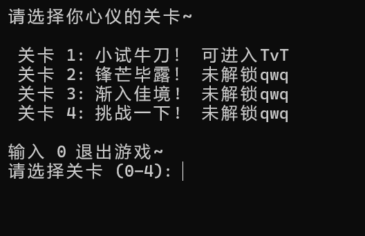

# Robotgame

A C++ robot programming puzzle game developed for the **Programming Fundamentals** course at Tsinghua University. Players write short programs to control a robot, move numbered blocks between conveyor belts and storage slots, and produce the output required by each level.

## Features

- Four interactive levels with sequential unlocking and saved progress
- Robot instructions for input, output, storage, arithmetic, and control flow
- Program input from the keyboard or a text file
- ASCII console interface showing the robot, conveyor belts, storage, and current instruction
- Animated execution with pause, single-step playback, and restart controls in version 1
- Sequential game-state display in version 2
- Instruction error reporting, output checking, and execution statistics
- A standalone submission version for online judge evaluation

## Preview

### Program Execution

The execution view displays the input and output conveyors, the robot's current block, the program listing, and the current execution state.



### Level Selection

The level menu shows available and locked stages. Completing a stage unlocks the next one, and progress is retained between sessions.

<p align="center">
  
</p>

## Structure

```text
robotgame/
├── main.cpp                 # Standalone online judge submission
├── src/
│   ├── robotgame_v1.cpp     # Animated console game with playback controls
│   └── robotgame_v2.cpp     # Sequential game-state display
├── docs/images/             # Game screenshots
├── robotgame.pdf            # Original course project specification
└── README.md
```

The interactive versions include the three required levels and an additional level that multiplies each input by eight. The online judge submission implements the three required test levels.

## Setup

Requires a C++ compiler supporting **C++11 or later**. The interactive versions require **Windows**, since they use Windows console APIs; version 1 also uses `conio.h`. Source files use UTF-8 encoding.

From the repository root:

```powershell
cd "Programming Fundamentals/robotgame"
```

## Run

### Interactive Game

Build both versions and launch version 1:

```powershell
cd src
g++ -std=c++11 robotgame_v1.cpp -o robotgame_v1.exe
g++ -std=c++11 robotgame_v2.cpp -o robotgame_v2.exe
.\robotgame_v1.exe
```

To use the sequential display version instead:

```powershell
.\robotgame_v2.exe
```

Select a level, review its input sequence and target output, then enter a robot program from the keyboard or load one from a text file. For file input, place the input file in `src/` and enter its filename when prompted. The first line is the instruction count, followed by one instruction per line.

Version 1 provides the following playback controls:

| Key | Action |
| --- | --- |
| Space | Pause or resume playback |
| Enter | Start execution or advance one step while paused |
| Left Arrow | Restart the current program |

Version 1 saves level progress in `level.txt`; version 2 uses `level2.txt`. After completing a level, press Enter to return to level selection and save progress. Additional prompts appear in the game interface.

### Online Judge Version

Build from the `robotgame/` directory:

```powershell
g++ -std=c++11 main.cpp -o robotgame_oj.exe
.\robotgame_oj.exe
```

Input begins with the level number, followed by the instruction count and the program. For example, the following program copies the first level's input blocks to the output:

```text
1
4
inbox
outbox
inbox
outbox
```

Expected output:

```text
Success
```

The judge version prints `Success`, `Fail`, or `Error on instruction X`.

See [`robotgame.pdf`](robotgame.pdf) for the original game rules, instruction set, and course requirements.
