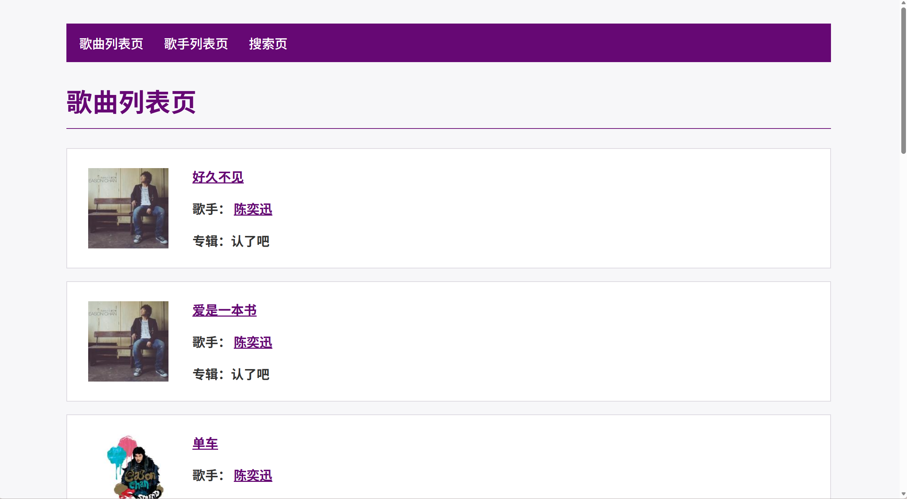
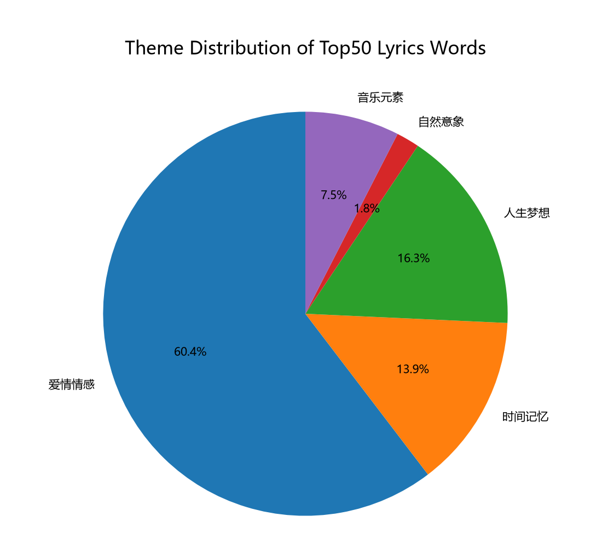

# python-spider-web-project

一个基于 Python 的 Web 数据爬取、展示与分析项目，实现数据爬取、SQLite 存储、Django Web 展示以及简单的数据分析与可视化。

目前已爬取约 **275 位歌手、1.25 万首歌曲和 3.6 万条评论**。

## 项目内容

- 简单爬虫练习
- 网易云音乐歌手、歌曲、歌词和评论数据爬取
- SQLite 数据存储
- 基于 Django 的 Web 数据浏览与搜索
- 歌词、评论数据分析与可视化

## 项目结构

```text
.
├── analysis/           # 数据分析脚本
├── demo/               # 简单爬虫练习
├── docs/
│   └── images/         # Web 与数据分析结果
├── spider/             # 网易云音乐爬虫
├── web/                # Django Web 应用
├── requirements.txt
└── README.md
```

## Web

基于 Django 实现歌手、歌曲等数据的浏览与搜索，并提供歌曲、歌词和评论等信息的展示。

<p align="center">
  
</p>

具体实现见 [`web/`](web/)。

## 数据分析

对爬取的歌词和评论数据进行了词频、主题分布、文本长度等简单统计与可视化分析。

<p align="center">
  
  
</p>

具体分析代码及其他结果见 [`analysis/`](analysis/) 和 [`docs/images/`](docs/images/)。

## 环境

```bash
pip install -r requirements.txt
```

爬虫部分需要安装 Node.js，并在 `spider/.env` 中配置 Cookie。

## 运行

### 爬虫

```bash
python spider/netease_cloud_music_spider.py
```

### Web

```bash
cd web
python manage.py runserver
```

数据分析脚本位于 [`analysis/`](analysis/)。