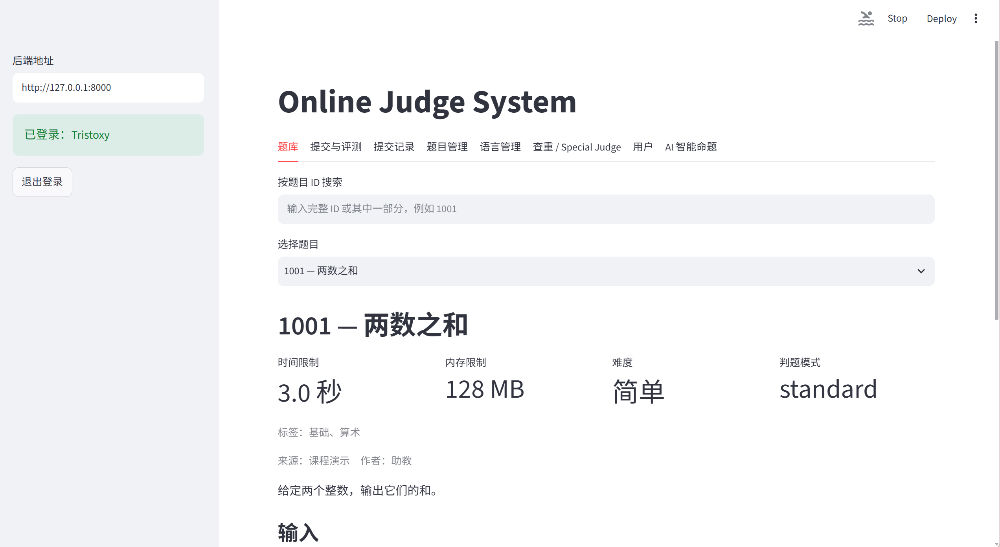

# OJ System

An online judge developed for the **Programming Practice** course at Tsinghua University. Built with **FastAPI** and **Streamlit**, it supports problem management, code submission and evaluation, user permissions, plagiarism detection, and optional AI-assisted problem generation.

**First recorded commit:** [September 3, 2026](https://github.com/Tristoxy/thu-labs/commit/c5fc92fbb37898ec96d42d493d0505ed8032f4f6). The original commit history and timestamps are preserved in this collection.

## Features

- Problem, user, and submission management
- Dynamic registration and configuration of judging languages
- Python and C++ code evaluation with time, memory, and output limits
- Standard Judge, Strict Judge, and Special Judge
- Submission history, test-case logs, and rejudging
- Python code similarity analysis based on program structure
- Optional AI-assisted problem generation and token usage tracking
- FastAPI backend and Streamlit web interface

## Preview



## Structure

```text
oj-system/
├── app/                       # Backend and core services
│   ├── api/                   # API routes
│   ├── core/                  # Configuration and shared components
│   ├── judge/                 # Code evaluation
│   ├── models/                # Data models
│   ├── plagiarism/            # Code similarity analysis
│   ├── repositories/          # Persistence
│   └── services/              # Business logic
├── frontend/                  # Streamlit interface
├── tests/
├── docs/                      # Screenshots
├── requirements.txt
├── requirements-dev.txt
└── requirements-frontend.txt
```

## Setup

Requires **Python 3.10+**. Evaluating C++ submissions also requires `g++`.

From the repository root:

```bash
cd "Programming Practice/oj-system"
python -m venv .venv
```

Activate the virtual environment:

```powershell
# Windows PowerShell
.venv\Scripts\Activate.ps1
```

```bash
# Linux / macOS
source .venv/bin/activate
```

Install dependencies:

```bash
python -m pip install -r requirements-dev.txt -r requirements-frontend.txt
```

## Run

Start the backend:

```bash
uvicorn app.main:app
```

In another terminal, activate the same environment and run the frontend from the project directory:

```bash
streamlit run frontend/app.py
```

- Web interface: <http://localhost:8501>
- API documentation: <http://127.0.0.1:8000/docs>

## Tests

Run from this project directory:

```bash
python -m compileall -q app tests frontend
python -m pytest -q
```
