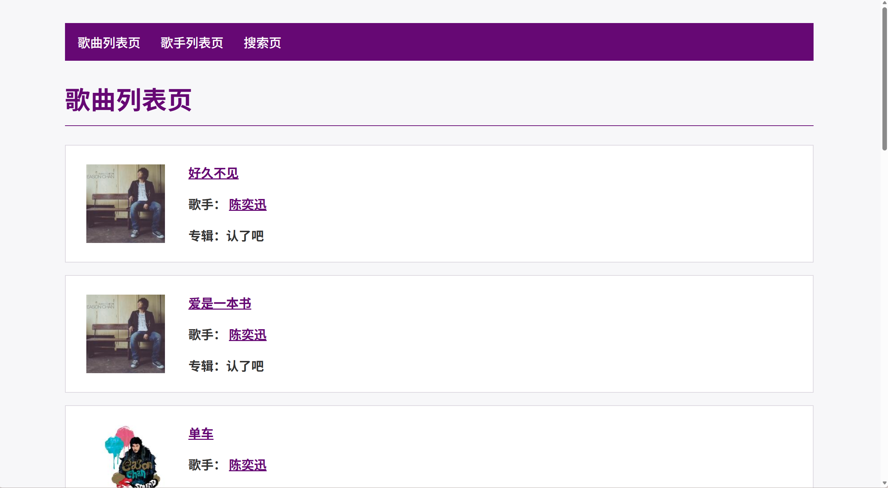
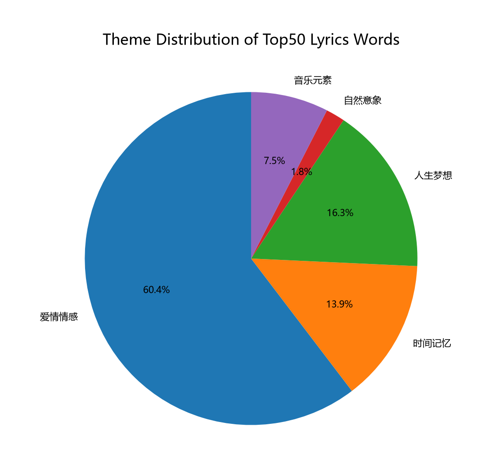

# NetEase Spider

A **NetEase Cloud Music crawler** developed for the **Programming Training** course at Tsinghua University. This project combines web crawling, SQLite storage, a Django web interface, and basic analysis of lyrics and comments.

The original collection includes approximately **275 artists, 12,500 songs, and 36,000 comments**.

## Features

- Introductory web crawling exercises
- Collection of artists, songs, lyrics, and comments from NetEase Cloud Music
- SQLite data storage
- Browsing and search through a Django web interface
- Word frequency, topic distribution, and text length analysis

## Structure

```text
netease-spider/
├── analysis/           # Data analysis scripts
├── demo/               # Introductory crawling exercises
├── docs/images/        # Web screenshots and analysis results
├── spider/             # NetEase Cloud Music crawler
├── web/                # Django application
└── requirements.txt
```

## Web Interface

The Django application provides browsing and search for artists and songs, with pages for lyrics and comments.

<p align="center">
  
</p>

See [`web/`](web/) for the implementation.

## Data Analysis

The analysis scripts explore word frequencies, topic distributions, and text lengths in lyrics and comments.

<p align="center">
  
  
</p>

See [`analysis/`](analysis/) for scripts and [`docs/images/`](docs/images/) for additional results.

## Setup

From the repository root, enter the project directory and install dependencies in a Python virtual environment:

```bash
cd "Programming Training/netease-spider"
python -m pip install -r requirements.txt
```

The crawler also requires **Node.js**. Copy `spider/.env.example` to `spider/.env` and configure your Cookie locally. Keep credentials out of version control.

## Run

Start the crawler from the project directory:

```bash
python spider/netease_cloud_music_spider.py
```

Start the web application:

```bash
cd web
python manage.py runserver
```

Data analysis scripts are located in [`analysis/`](analysis/).
